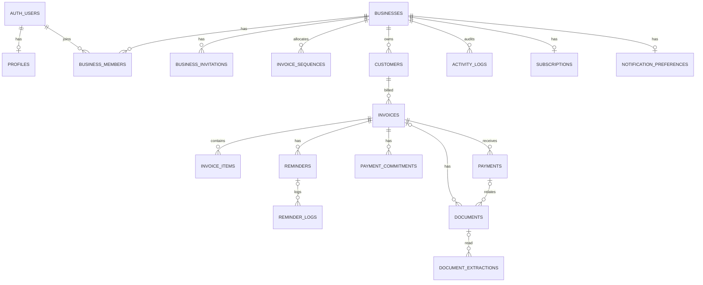

# PAIDFLOW database architecture — Step 1B

Local migration files only; no remote project has been selected or migrated. The application still contains only the marketing preview. IDs are UUIDs and timestamps are `timestamptz` unless noted. Monetary amounts are INR paise (`bigint`); percentages are integer basis points; quantities are `numeric(12,3)`. `profiles` extends Supabase `auth.users`; there is no separate application users table.

## Relationships

Documents can also reference a customer. A payment can reference a pre-existing document as proof; both must refer to the same business and invoice. The payment/document references are intentionally nullable to allow the document to be registered before payment. No Storage bucket, object or signed URL exists in this step.

## Table inventory, ownership and indexes

Every table has RLS enabled and forced; access is described in `database-security.md`. Unless stated otherwise, `id` is the UUID primary key and `business_id` references `businesses(id)`. Composite references use `(business_id,id)` unique keys; `invoices` additionally has `(business_id,id,customer_id)` and reminders/payments have composite keys needed to enforce related-record consistency. Existing unique constraints already create indexes.

| Table | Purpose, ownership, foreign keys and constraints | Key indexes / access |
|---|---|---|
| `profiles` | PK `id` → `auth.users`; self-owned, language constraint | PK; self-only RLS |
| `businesses` | Workspace; `created_by` → auth user; INR, April FY, GST registration, state and prefix checks | PK; membership-gated reads |
| `business_members` | Membership; business and user FKs; one per pair; enum role/status | unique `(business_id,user_id)`; partial `(user_id,business_id)` for active memberships; RPC-only writes |
| `business_invitations` | Pending invitation; business/inviter FKs, hashed token unique, role and expiry checks | business/created; token hash unique; owner/admin column-limited reads, RPC-only writes |
| `invoice_sequences` | Counter per business/FY; composite PK | PK; read-only to members; allocation RPC only |
| `customers` | Tenant CRM record; creator → auth user, optional GST/state/credit checks | unique `(business_id,id)`; business/name for active listings; operator writes |
| `invoices` | Draft or issued/cancelled snapshot; composite business/customer FK; unique business/number and business/id/customer; FY/date, tax, totals and status constraints | business/due for open issued list; business/customer/date; business/status/FY; draft-only client writes |
| `invoice_items` | Line items; composite invoice FK; quantity, paise, basis-point and arithmetic checks | business/invoice/order; editable only while parent is draft |
| `payments` | Ledger; composite business/invoice/customer FK and same-invoice proof FK; positive amount, verification/void consistency, idempotency unique per business | recorded business/invoice for ledger sum; business/payment date; RPC-only writes |
| `payment_commitments` | Promises, composite invoice/customer FK; positive amount and constrained status | business/promised date for pending queue; operator writes |
| `reminders` | Planned follow-ups; composite invoice/customer FK, enum-like language/tone/category/status checks | business/status/date queue; operator writes |
| `reminder_logs` | Append-only manual actions; composite reminder/invoice/customer FKs | business/invoice/time timeline; operator inserts only |
| `documents` | Document metadata; business, customer, invoice and payment composite FKs; same-tenant path prefix, positive size | business/invoice/category/time; operator metadata insert only; actual object access is not implemented |
| `document_extractions` | OCR review staging; composite document and confirmed-invoice FKs; confirmation/status consistency | business/status/time; member read-only until a reviewed write flow is built |
| `activity_logs` | System-written event trail; business and actor FKs | business/time; members may read, ordinary users cannot write |
| `subscriptions` | Future plan metadata, **not billing**; PK/FK business | PK; read-only to members |
| `notification_preferences` | Workspace reminder preferences; PK/FK business, constrained settings | PK; owner/admin update |

## Financial rules and boundaries

- Invoice header CHECKs ensure nonnegative paise, discount ≤ subtotal, `taxable = subtotal - discount`, `total = taxable + tax + shipping + additional charges + round-off`, and `balance = total - paid`, without overpayment. Round-off is limited to ±99 paise. Stored money is bounded to JavaScript's largest exact integer (`9,007,199,254,740,991` paise); intermediate arithmetic is PostgreSQL `numeric` to avoid overflow. Do not use JS floating point for tax or quantity calculations.
- Lines require positive quantity, nonnegative prices, `taxable = round(quantity × unit_price) − discount`, and `tax = round(taxable × rate_bps / 10000)`; line total equals taxable plus tax. `numeric` rounding here is PostgreSQL rounding to the nearest paise, half away from zero. Supply-specific distribution and sums across all lines are validated when issuing. Intra-state splits may differ by at most one paise per line; inter-state uses IGST; non-GST has zero tax.
- This is a deliberately limited GST-oriented foundation, **not a tax compliance engine**. Shipping and other charges are added outside line taxable/tax sums in this version. Taxable freight, exemptions, cess, discounts allocated across tax rates, credit notes, reverse charge, export/SEZ/UT-specific rules, and tax-document classification require a separately reviewed design before real issuance. GSTIN regex is format-only, not government verification.
- Draft headers can temporarily disagree with their item totals while being edited. `issue_invoice` locks the invoice and rejects an empty invoice, nonpositive total, mismatched sums, invalid line tax distribution or incompatible registered business/origin. Line mutations lock the same invoice; issued lines and authenticated header edits are blocked. Cancellation, archiving, send-state and credit notes have no client mutation API yet.
- `paid_paise` and `balance_paise` are cached and checked against the sum of non-voided payments by deferred constraint triggers at commit. Client roles cannot write payments or cached paid totals directly. No LLM arithmetic or user-submitted balance is authoritative.
- Settlement and overdue are not persisted as mutually exclusive statuses. Future queries must derive settlement and overdue separately, using a consistent `Asia/Kolkata` date; partially paid invoices can also be overdue. No dashboard calculations exist yet.

## Payment transaction

`record_payment` authenticates and locks the caller's active membership, locks the tenant-scoped invoice `FOR UPDATE`, checks for an existing business-scoped idempotency key and matching parameters, requires an issued invoice, recomputes non-voided ledger sum, rejects inconsistent cache and overpayment, inserts a user-recorded payment, updates totals and writes a minimal audit record in the same transaction. A retry with identical parameters returns the original payment and the **current** invoice with `replayed = true`; a reused key with different parameters fails. A key used concurrently for different invoices can return a unique-constraint error and must not be retried with different details. A proof is only `proof_attached`, never verified.

`void_payment` is owner/admin-only, locks invoice then payment, requires a reason, recomputes and checks the ledger, marks rather than deletes the payment, updates the cache and audits atomically. Replaying a void returns the already-voided row. These functions use row locks and are tested with competing local transactions, but production scale/load and failure recovery remain to be tested.

## Invoice numbering

`allocate_invoice_number(business_id, invoice_date)` authorizes owner/admin/manager, derives the FY start year (Apr–Mar), and atomically upserts the `(business_id,fy_start_year)` counter. It returns e.g. `PF-2026-27-000001` and never truncates a counter beyond six digits. A business-wide invoice number unique constraint is the final safety net. Allocation is not issuance and gaps are expected after abandonment/rollback or prefix changes; legal sequence rules must be reviewed for the eventual invoice workflow.

## Events and future work

Triggers log business/customer/invoice creation, invoice issuance, member access changes, invitations, and document **metadata registration**. Payment record/void RPCs log their own events. Metadata is allowlisted to IDs, role/status, category, and amount; no tokens, passwords, message contents or full documents are recorded. A document download/upload event cannot truthfully be emitted yet: real storage authorization, object existence and audited download endpoints are future work. Audit records are append-only for normal users, not tamper-proof against database administrators.
