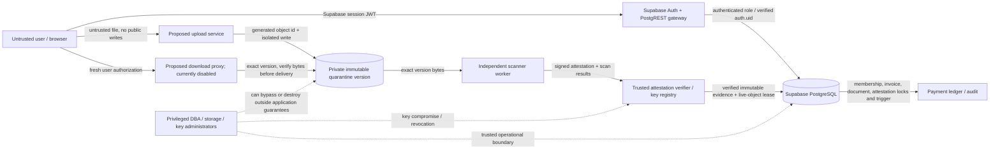

# Step 13 — Supabase payment-proof security architecture and enforcement review

**Status: DESIGN; SECURITY ACCEPTANCE FAIL / BLOCKED.** After later approval, a Supabase-specific deny-all migration was prepared at `supabase/migrations/20261107000700_deny_payment_proof_attachment.sql` and tested locally only. It has not been deployed and does not protect the hosted database. No scanner, upload, download or proof-enabling path is implemented. No hosted Supabase project, database, Storage, Auth, PostgREST or credentials were accessed. No financial migration or RPC was modified. The current local-lab global download/preview hold and app-level password-recovery block remain in force. No merge, release or deployment is authorized by this phase.

The working production candidate remains **Supabase Auth + Supabase database**; Better Auth, Neon and storage labs are separate local experiments. No dual-write, identity migration, or import of lab SQL is proposed. This design is subject to explicit later approval, real-provider verification and independent security review. The existing UI is **not** a security boundary.

## 1. Existing code trace and vulnerability inventory

All observations below are of repository migrations/code and local mock-Auth PostgreSQL. Actual hosted versions, grants, exposed schemas and Storage policies are unknown.

1. `supabase/migrations/20261107000100_initial_schema.sql` defines `documents` with client-supplied `business_id`, optional `customer_id`, `invoice_id`, `payment_id`, `category`, `storage_path`, size and nullable `sha256_checksum`. The path check only requires a tenant-ID prefix; it does not prove an object exists, is immutable, matches its bytes or was scanned. There is no document lifecycle, object version or scan/attestation state. `documents` has FKs for tenant/customer/invoice and `(business_id,payment_id,invoice_id)`; PostgreSQL composite FK checks permit NULL components. Thus a NULL customer is not evidence of an exact customer match.
2. `20261107000200_multi_tenant_rls.sql` revokes broad table grants from PUBLIC/anon/authenticated, enables **and forces RLS**, and grants authenticated users tenant-wide SELECT, plus INSERT on `documents` with an `uploaded_by=auth.uid()` and active owner/admin/manager membership check. No authenticated document UPDATE/DELETE grant is established by these files. The INSERT policy does not check scanner, category, object existence or real file bytes. The same broad tenant-read policy on `documents` and `activity_logs` lets all active tenant members read permitted columns, including `storage_path`; later column-level restrictions require revoking the table-level SELECT grant first. Owner/admin/manager can insert metadata directly; an accountant cannot use this INSERT grant but can call the payment RPC with a document registered by another permitted actor.
3. `20261107000400_payment_ledger_functions.sql`: `public.record_payment(...)` is `SECURITY DEFINER`, fixed `search_path=pg_catalog,pg_temp`, and explicitly EXECUTE-granted to `authenticated` (not PUBLIC or anon). It calls `paidflow_private.require_business_role` for active owner/admin/manager/accountant; that helper locks the membership row `FOR SHARE`. The RPC locks the invoice `FOR UPDATE`, checks the idempotency key and exact original parameters first, and returns the historical payment on replay. For a new payment it inserts `proof_document_id` directly, sets `verification_status='proof_attached'`, updates balance and appends an audit event in the same transaction. It does **not** consult document lifecycle, scan state, object existence, category, `documents.payment_id`, bytes or attestation. The FK `(business_id,proof_document_id,invoice_id)` rejects a non-NULL missing document, cross-tenant document or wrong-invoice document; it does not validate the rest. NULL proof deliberately remains valid as a `user_recorded` payment.
4. The RPC and table are in `public`. Where the hosted PostgREST endpoint exposes that schema and honors these grants, an authenticated caller can invoke `/rpc/record_payment` directly and need not go through UI/application logic. Local SQL-as-`authenticated` tests reproduce this **potential** direct path; actual hosted PostgREST exposure and role behavior were not tested. `paidflow_private.require_business_role` checks active membership, not itself the hosted provider's email-verification/session-revocation guarantees. Auth/session semantics must be independently verified.
5. The base schema's payment-to-document FK alone does not enforce `documents.payment_id = NEW.payment.id`, exact non-NULL document customer, document category or one-proof-per-payment. Local tests demonstrate a same-invoice metadata-only document with no object or scan accepted as proof, and a document already linked to a different payment on that invoice accepted for another new payment. Both observations are **FAIL**, not control passes. A non-NULL cross-tenant, wrong-invoice or nonexistent document ID was rejected in the mock DB; that cannot establish byte/lifecycle safety. Deleted or revoked objects cannot be represented or checked by this base schema; an externally missing, deleted, replaced or revoked object can therefore remain represented by an eligible-looking metadata row (the specific real Storage operation is untested).
6. Direct authenticated payment INSERT/UPDATE/DELETE has no grant in the base migrations. However the payment RPC runs with its definer's privileges; absence of direct table DML is not protection against an unsafe RPC. `void_payment` also runs as definer, locks invoice then payment, and preserves a voided historical row. Deferred ledger triggers check cached totals even for privileged writes, but do **not** validate proof safety. Owners, migration roles, service roles, inherited privileges, direct SQL, other definers, disabled triggers, replication and administrator/bypass access can have different capabilities; enumerate them on the real target before approval. The migration-owner precondition explicitly requires superuser or BYPASSRLS; FORCE RLS does not protect against a privileged owner that can bypass/alter policy or triggers.
7. `20261107000500_indexes_and_audit.sql`'s `audit_document_uploaded` trigger emits **`document.registered`** after metadata INSERT, not an upload/scan event. `record_payment` writes `payment.recorded`, not evidence of file safety. No production Storage buckets, object policies, signed URLs, document lifecycle service, scanning pipeline or public Supabase document/payment-proof UI/API are implemented by the inspected repository. Existing hosted Storage resources or external privileged access, if any, are unknown and cannot be ruled out.

### Bypass surface and classification

| Path or actor | What the checked-in schema permits / constrains | Evidence |
| --- | --- | --- |
| Authenticated owner/admin/manager with tenant access | INSERT same-invoice metadata, then call `record_payment` with that ID, with no object/scan; may submit a stale/nonexistent storage path or an `other` category. | **FAIL:** local actual SQL with mock auth; transaction rolled back. |
| Authenticated accountant | Can execute payment RPC; may use an already registered same-invoice metadata row, despite no document INSERT grant. | **FAIL:** local actual SQL as accountant, with manager-registered metadata; rolled back. |
| Existing document linked to other payment | `documents.payment_id` is not consulted by payment FK/RPC, as long as it refers to a payment on same invoice. | **FAIL:** separate local actual-SQL reproduction; transaction rolled back. |
| Wrong/missing document UUID, different invoice or tenant | Composite payment FK rejects non-NULL invalid reference; no ledger/audit change in tested attempts. | **PASS (local mock DB only)**; direct PostgREST not tested. |
| Deleted, revoked, modified or missing **object** with retained document row | Base schema has no object version/lifecycle/attestation to test. Any independent Storage changes are invisible to the RPC. | **FAIL design:** no guard; exact hosted behavior **NOT TESTED**. |
| Direct PostgREST, service role, DB owner, other RPC/trigger/view or storage operator | Possible access is determined by actual gateway exposure, role memberships, grants/default grants, RLS, storage policies and owner powers, not UI. Owners/definers can bypass ordinary RLS or disable triggers. | **BLOCKED** pending permitted real-provider review; no claim of a hosted exploit. |

## 2. Trust model and boundaries

- **Untrusted:** client parameters, filenames, MIME, hashes, object selectors, URL labels, local SDK metadata, session cookies from the client, client-submitted scanner IDs and any UI checks. The authenticated role may call public RPCs directly. Client-set claim/GUC values are trusted only when populated by a verified gateway; direct DB connections with role/claim-setting ability could impersonate users.
- **Trusted, separately controlled:** gateway signature/session verification; non-owner database enforcement code and its audited owner/grants; immutable-version storage controls; independently operated scanner and attestation-signing key; verifier/issuer registry and policy controller; audit sink; administrators within their explicitly restricted authority. The scanner cannot alter ledger, and the app runtime cannot issue scanner verdicts. DB/storage/issuer administrators remain powerful and cannot be made tamper-proof merely by RLS. Separation of duties, scoped credentials, approvals, access audit and external tamper-evident archival are required.
- **Failure model:** provider/DB/scanner/verifier/storage/audit outages, stale signatures or policy, clock drift, missing object/version, malformed inputs and permission changes all deny new proof attachment; no fake “clean” status. A scan non-detection is not proof that a file is harmless. Historical ledger entries are not deleted on proof invalidation.

## 3. Proposed lifecycle and scanner attestation

The visible eligibility progression is `uploaded → quarantined → scanning → structurally_valid → malware_clean → eligible_for_payment_proof`. `uploaded` is a private staged record, not public access. `scanning` includes the isolated structural and malware work; `structurally_valid` means only file-format checks passed, never malware-clean. A file is eligible only after the independent malware result and all attestation, object, role, policy and context checks below pass. Structural parsing must itself be isolated and bounded. Failed, timeout, unsupported, encrypted, malformed, malware-positive, unavailable, expired or uncertain results stay held. `revoked`, `invalidated`, `delete_pending` and `deleted` are non-eligible terminal/side states; re-scan produces new evidence, not silent mutation of old attestations.

**Proposed signed payload (v1):** a deterministic, versioned canonical encoding (e.g. canonical CBOR, finalized in implementation review), signed with domain separation such as `paidflow:proof-scan:v1`. Reject unknown versions, ambiguous encodings, duplicate fields, unsupported algorithm and malformed/overlong data. At minimum include:

| Field | Requirement |
| --- | --- |
| Tenant and document ID | Exact immutable UUIDs, plus purpose `payment_proof`; scoped to one app/environment to prevent cross-project replay. |
| Object identity | Storage provider/bucket, server-generated opaque immutable key and **exact immutable version/generation**, bound to tenant/document. Do not put secrets or user filenames in the key. A versionless or overwriteable key alone is insufficient. |
| Byte evidence | SHA-256 and byte length over the exact version's full raw bytes actually scanned, with explicit algorithm/version; not client assertions or ETag assumptions. |
| Scanner | Registered scanner identity, engine/build version, signatures/definition-set version and digest, definition freshness, policy version and scan-job nonce. |
| Result/time | Structural outcome separately from malware result; scan start/finish and signed issuance/expiry using trusted time. Only an explicitly permitted `malware_clean` outcome can qualify. TTL/freshness policy is approved configuration; absent/expired/future timestamps, clock uncertainty or unknown policy fail closed. |
| Authenticity and revocation | Approved signing algorithm/key ID, signature, issuer, audience/environment, unique attestation ID, creation/revocation/invalidation state, key validity window and reason/time. Key compromise or policy revocation invalidates affected evidence; key and attestation states are checked at attachment and access. |

The scanner signs with a dedicated private key held outside the application runtime and database. A trusted verifier validates signature, signed fields, registered scanner/key, nonce/job linkage, replay protection, time/policy, exact version and byte digest; only a narrowly scoped verifier role can insert immutable validated attestations. The DB attachment trigger must **independently verify the signature with pinned current public key and policy/revocation state at attachment**, using an audited, available, fail-closed database verifier. Do not assume a suitable hosted Supabase extension, algorithm, key management or verifier exists: if unavailable, errors, revoked/unknown key, missing policy or unsupported signature, reject. No runtime role/user can INSERT/UPDATE attestation, key registry, object identity, `malware_clean`, signature-validation results or lifecycle state via table grants, definer functions, PostgREST, nested ownership or settable GUCs. Only verified scanner ingestion may promote state; no client may assert its identity. Separate revoker can invalidate but not issue. Key rotation, least privilege, replay uniqueness, audited break-glass and compromise recovery are mandatory.

**Staleness and storage atomicity:** version/generation/key/hash/length are immutable; changing any bytes or object identity creates a new version/record and invalidates earlier eligibility, never reuses an old attestation. A trusted verifier must perform a fresh exact-version existence/integrity check and issue a short-lived, single-use signed object-presence lease bound to the document/version/hash/length and intended operation. To retain the existing RPC signature, bind it to business, authenticated actor, invoice, document/version and the existing payment idempotency key (not a client-controlled payment ID); the trigger checks those bindings against `NEW` and `auth.uid()` and consumes the lease exactly once. DB checks lease signature, expiry, one-time nonce and policy during the attachment transaction. A lease is not itself a malware attestation. Provider-enforced immutable retention/object lock and a single controlled deletion path must keep that version present through the lease/transaction and required retention; DB row locks serialize application-level invalidation and deletion. No caller can extend a lease. Missing object, inaccessible Storage, lease issuer/verifier outage, expired lease or failed integrity check deny new attachment.

**Critical limitation:** PostgreSQL and external object storage do not share an atomic transaction. A HEAD, lease or DB lock alone cannot prove bytes still exist at commit if an independent privileged actor or provider can delete/replace them, or if storage becomes unavailable immediately after checking. The architecture is conditional on verified provider-enforced immutable-version retention and an administrative/deletion threat model; it cannot promise availability against privileged deletion, service loss or a compromised scanner. A BEFORE trigger verifies at statement time, not at commit; a caller can hold an open transaction beyond the lease expiry. A timeout or deferred trigger alone is not proof of an exact commit-time condition. The proposed linearization point is the eligibility check while the document, revocation and key locks are held; retention must extend beyond any possible commit or abort, with a provider-enforced bound and trusted transaction management, not merely the lease TTL. If a provable bound cannot be established for all writers, this design remains BLOCKED rather than assuming a signed lease solves atomicity. Provider behavior, transaction deadlines, commit semantics and races must be proven; if those premises cannot be enforced, **keep all new proof attachments disabled**. Availability after a committed payment is not guaranteed by DB atomicity; failures trigger holds and incident recovery, never a fabricated clean result.

## 4. Proposed database enforcement and lock protocol

This is a design proposal, **not SQL to execute**. Existing `record_payment` signature, financial RPC bodies and existing migrations remain untouched in this phase. Future implementation requires separately approved additive Supabase-specific migrations and rollback review:

1. Add private, RLS-protected/owner-restricted append-only document-version records, lifecycle events, signed attestation/key/policy registry and one-time object-presence leases with strict unique IDs/FKs. Never copy lab migrations. Require exact business/invoice/customer, document/version/key/hash/length, category `payment_receipt`, eligible state, issuer/key state, expiry and lease. Existing rows default to **unknown/unscanned**, not clean; do not invent attestations or silently attach existing files.
2. Propose a narrowly owned, fixed-search-path `SECURITY DEFINER` **BEFORE INSERT OR context-changing UPDATE** trigger on `public.payments` so all paths—including direct PostgREST RPC and security-definer inserts—must satisfy the same invariant. It accepts NULL proof under the current contract, but any **new non-NULL** proof is checked. Query the document by both business and ID, lock and compare exact invoice, required customer, object version and category; reject absent/mismatched `document.payment_id` unless NULL or equal to `NEW.id`. Proposed policy: a document may be proof for at most one payment, including voided payments; check existing references under the document lock. This is a **product/contract decision requiring approval**; do not add a global unique index blindly where historical duplicates may exist. Audit existing duplicates and design additive handling first. If approval is denied or ambiguous, block proof attachment rather than silently choosing semantics.
3. Enforce all attestation signature/policy/revocation/time, live immutable object lease and document state under locks. Fail generically without leaking cross-tenant existence, object key, token or scanner metadata. Ensure no `WHEN` clause or UPDATE skip permits changed tenant/invoice/customer/proof or payment-ID linkage to escape; test unchanged non-context updates such as void separately. Run enforcement as a least-privileged non-login owner, pinned `pg_catalog,pg_temp` search path, schema-qualified object names and revoked PUBLIC/anon/authenticated execution. With FORCE RLS, give that owner only explicit policies/privileges required for enforcement, and prove they work inside the trigger; if that is not possible, any BYPASSRLS design requires separate justification, scope review and approval rather than an automatic broad bypass. Validate PostgreSQL trigger/function EXECUTE, ownership, RLS, `session_replication_role`, default privileges and role inheritance in the real target rather than assuming any one revoke is sufficient. DBA/superuser and compromised owner remain outside the invariant unless their privileges are separately constrained/monitored.
4. Preserve the current RPC contract: invoice/ledger arithmetic, dates, errors as far as practicable, user-recorded no-proof payments and audit remain unchanged; test applications before any rollout. A valid retry with identical `idempotency_key` returns the existing payment before INSERT and **does not reattach a proof**, even if later revoked. It must never mint a new grant or expose bytes; any future access reauthorizes against current state. Same key with changed parameters remains rejected; concurrent duplicate calls create one ledger entry. Voiding keeps historical proof reference and financial/audit history; context-unchanged void is not blocked by a now-revoked document. Review response fields: never imply `proof_attached` means malware-clean or verified payment.
5. Existing RPC lock order starts membership (`FOR SHARE`) → invoice (`FOR UPDATE`) → payment insertion. Proposed trigger extends this to **membership → invoice → document/version → attestation/key/policy → lease/assignment** in a documented deterministic order. Any attach, rebind, revoke or logical delete path that also touches an invoice must take the same order; service paths that do not require membership begin with the invoice. A global key revoke locks/updates only the key record and does not lock invoices/documents in reverse; attach takes a conflicting key lock before it checks validity. If attachment holds its locks first it may commit before revocation; if revocation commits first the attachment must fail. Existing access after later revocation is denied; it cannot retract bytes already delivered. Test both interleavings, deadlock/timeout recovery, isolation-level visibility, same-doc concurrent attachments, direct privileged writers and membership suspension. Never perform remote network calls while holding DB locks.
6. Scan/invalidation/deletion use a controlled, idempotent saga: commit an immediate logical deny and audit under required locks before external object changes; storage deletion executes later with least-privilege credentials, retries and reconciliation. A retained historical proof is logically held even when bytes are retained. Any external deletion not mediated by the saga violates the prerequisite and requires immediate hold and incident response.

### Proposed migration order / release gates

- **0 — inventory, no changes:** obtain separate approval for a read-only hosted review. Enumerate schema and migration history, triggers, role memberships, owner/BYPASSRLS, function signatures/search paths/privileges, exposed schemas, Storage bucket/object policies and any existing external service-role access. Inventory document/payment references, NULLs, duplicate proof links, active grants and historical data; record counts/IDs privately without exporting customer content. Determine provider version, plans, extension support and maintenance/rollback window. Stop on unexpected drift.
- **1 — block first:** in a later separately approved change, add a production-specific fail-closed invariant/trigger to deny *all new non-NULL proofs*, preserving NULL-proof payments, same-key historical replay and voids. Separately revoke unnecessary direct `documents` INSERT/storage grants after compatibility review; a UI or app-only gate cannot replace DB enforcement. Deploy deny trigger and privilege changes atomically where possible; verify direct RPC and all granted roles before proceeding. **Candidate migration prepared and mock-tested locally only; not applied to hosted Supabase.**
- **2 — schema/evidence only:** add private immutable-version, attestation, key/policy, revocation, lease, audit and assignment structures. No permissive grants/defaults; all legacy metadata remains unknown/held. Inspect historical duplicates before any new uniqueness constraint, and do not validate/rewrite legacy payments as if newly attached.
- **3 — controlled writer/verifier:** deploy independently reviewed restricted upload, scanner, verifier, key lifecycle, immutable storage, revocation and audit components with delivery/attachment still disabled. Exercise synthetic tests in a disposable real-provider environment; no real data until separate approval.
- **4 — enable only after gates:** integrate the DB trigger's eligibility predicate while retaining fail-closed default. Evaluate verified provider version and Storage semantics, role/grant and PostgREST direct-bypass tests, attestation cryptographic/race/expiry tests, outage drills and audit availability, historical replay, backup/restore, legal retention and independent review. Explicit separate approval required before any production migration, feature enablement or rollout. No step authorizes scanner/Garage installation here.

## 5. RPC, role and grant matrix

Proposed grants are objectives, not current hosted facts. Review both object and column grants, functions, schema visibility, inherited memberships, default privileges and PostgREST schema cache.

| Principal / operation | Current repository baseline | Proposed later enforcement |
| --- | --- | --- |
| `anon` / PUBLIC | Explicitly revoked from payment RPC and listed app tables in migrations. | No payment/document/attestation/lease/key access, and no inherited EXECUTE or direct Storage object access. |
| `authenticated` viewer/suspended | Tenant-read granted; viewer/suspended cannot pass payment role check (suspended has no active membership). | No proof mutation or scan state grants; fresh active role/session checked each operation. Do not infer global confidentiality from tenant-read policy. |
| Authenticated owner/admin/manager | Metadata INSERT and tenant SELECT; `record_payment` execute. | Direct metadata INSERT and raw key SELECT removed or column-restricted in separately reviewed migration; narrow server-authorized upload/registration path and proof trigger; direct RPC cannot bypass trigger. |
| Authenticated accountant | Payment RPC execute; no document INSERT grant. | Existing allowed payment permission retained as approved; attaching proof subject to identical trigger and current membership; no scan/lease writes. |
| Application server / browser credentials | Supabase user session; hosted roles/keys unknown. | No service-role key in browser. Server uses narrowly scoped trusted identity and user context, not user-supplied `auth.uid()`/GUC; cannot issue clean, forge leases or bypass trigger. No service-role fallback. |
| Scanner signer | No production scanner role in repo. | Read exact private object version, sign scan result; no payment/ledger, key-registry administration or broad object delete. |
| Verifier / lease issuer | No production role in repo. | Validate trusted signatures/bytes, write constrained evidence through narrow callable API; cannot record payment or set unrelated policies/keys. Explicitly treat this role as part of TCB. |
| Revoker / policy-key admin | No production role in repo. | Separate roles can revoke/invalidate, not manufacture clean attestations; key/role changes dual-controlled and audited. |
| Trigger owner / migrator / service role / DB or Storage admin | Definer owners must bypass RLS for current helpers; actual hosted roles unknown. | Non-login, minimally privileged owner; migration and service credentials isolated, no app use. DBA/superuser/storage admin retain ultimate power and are monitored; validate trigger bypass/replication and object-lock capabilities. |
| Historical replay / `void_payment` | Existing replay returns same payment; void retains row. | Same financial behavior, no implicit new proof attach or byte access; use current permission checks and fresh independent access checks. |

## 6. Storage, revocation, history and audit design

- **Tenant authorization:** never infer authorization merely from an opaque key, tenant prefix or possession of a signed URL. A server-mediated exact-version read requires verified user session, current active membership and area/role authorization, and matching DB document/tenant state. Default deny all anonymous/direct bucket access. Raw key/version should not be exposed to normal clients; revoke broad table-level SELECT before regranting safe columns and check views and RPC JSON. Inspect real Storage RLS, CDN, bucket permissions and service credentials.
- **Download/preview:** remain disabled. Only after separately approved implementation and security testing, allow authenticated proxy reads of the exact immutable version. Verify full bytes/length/hash **before** returning any bytes, with bounded secure temporary buffering; reauthorize as required for long transfers, `no-store`, safe content-disposition/CSP and appropriate controls. Preview is not safe merely because it is inline; serving potentially active content requires its own isolation/sanitization design. Already-delivered bytes cannot be revoked.
- **Legacy grants:** revoke/delete stored grant records and rotate keys only with an approved impact plan; invalidate all historical presigned URLs at the provider layer where possible. If the provider cannot revoke existing bearer URLs, wait their provable maximum TTL and/or deny the underlying object with verified Storage policy; unknown grants mean the hold remains. Rotating an app key does not revoke provider-issued URLs by itself.
- **Logical versus physical deletion:** immediately set a non-readable/non-attachable state under the database lock and revoke leases/attestations; retain payment references, financial ledger and immutable audit. Physical removal is asynchronous and separately authorized under legal retention, versioned object-lock and incident/reconciliation rules. Historical referenced proofs remain inaccessible when unsafe regardless of whether bytes are retained. No delete or overwrite may silently rebind a historical payment to new bytes. Privileged direct storage access can defeat the app hold and must be restricted/monitored independently.
- **Audit:** allow events include authorized registration, quarantine, scan start/result, attestation accepted/invalidated, proof attachment, download/preview only after successful byte delivery, revocation, retention and physical deletion outcome. Denials/outages require generic operation/reason/time/verified actor; attribute tenant/document only after authorization and revalidation, otherwise unassigned. Never store content, filenames, raw paths, signed URLs, cookies, JWTs, tokens or arbitrary untrusted error strings. Success events are atomic with DB changes where possible; a failing DB transaction rolls back any in-transaction denial log, so use a separately protected append-only sink/transaction for denied attempts, with backpressure, rate limits, alerts, retention and outage behavior. Log failure cannot authorize access or claim a denial was durably recorded. DB owner/runtime compromise can still forge/erase DB audit; external durable tamper-evident storage and incident response require separate review.

## 7. Explicit threat and negative-test matrix

**Status definitions:** PASS = only the specifically named local baseline/lab control was observed, not proposed production enforcement; FAIL = requirement is violated or demonstrated unprotected; BLOCKED = prerequisite/provider unavailable; NOT TESTED = test designed but not run. Demonstrating a vulnerability is always **FAIL**, never counted as a security pass. All proposed control tests below assert unchanged payment count, invoice balance, legitimate audit and no bytes returned on denial unless expressly testing an idempotent replay. HTTP/PostgREST tests must run only against a separately verified disposable real-provider stack, not the hosted project.

| ID / adversarial setup | Exact expected assertion for eventual production design | Current evidence/status |
| --- | --- | --- |
| T01 Cross-tenant document ID | Tenant A authenticated payer calls RPC with B's proof ID, including direct PostgREST; generic rejection, no ledger/audit mutation or B data leak. | **PASS** base mock SQL FK; PostgREST and proposed trigger **NOT TESTED**. |
| T02 Wrong invoice/customer/payment | Same-tenant proof on invoice B, wrong customer, or document already assigned to a different payment rejected; exercise NULL customer and duplicate/voided references. | Wrong invoice **PASS** mock SQL FK; different same-invoice payment **FAIL** demonstrated; stricter customer/assignment control **NOT TESTED**. |
| T03 Metadata-only/unscanned | Insert valid-looking document row with no upload or scan and invoke `record_payment` directly as authenticated manager; deny non-NULL proof. | **FAIL** base mock SQL accepted it; no real object or attestation. |
| T04 Missing object/document | Nonexistent document UUID and valid metadata whose exact object version is absent both deny; differentiate nothing to user. | Missing UUID **PASS** base mock FK; absent object **FAIL design / NOT TESTED** on Storage. |
| T05 Changed bytes/version | Scan version A, replace/change bytes/version/key/length or digest, then attach; old signature/lease denied; verify zero bytes returned. | **BLOCKED**: no real immutable Storage or scanner. |
| T06 Stale attestation | Expired scan/definitions/policy, future timestamp or expired lease, wrong job nonce/version must deny under trusted clock. | **NOT TESTED**; no verifier/policy exists. |
| T07 Revoked attestation/key | Attach after committed attestation/key revocation and after policy invalidation; deny; in-flight lock order behaves as specified. | **NOT TESTED**. |
| T08 Deleted/revoked lifecycle | Try attach and old grant after logical delete/revoke, including retained historical record; deny new association and bytes, preserve history. | **PASS local lab** for new revoked/deleted/unscanned proof and global hold; Supabase proposal **NOT TESTED**. |
| T09 Payment vs revoke/delete race | Hold invoice/doc lock in each order, run competing payment and revocation/deletion, require defined serialized result and no partial ledger. Include deadlocks/timeouts/retries. | **PASS local Neon/storage lab** for its own lock/retention behavior using synthetic fixtures; notably it rejects revocation/deletion once payment wins, unlike the proposed post-commit logical revocation policy. Supabase trigger and proposed semantics **NOT TESTED**. |
| T10 Direct RPC / table bypass | Use valid JWT against PostgREST `record_payment`, direct `documents` INSERT, alternate role/function/view and direct table DML; reject untrusted new proof even if UI absent. | **FAIL** mock authenticated SQL RPC accepts metadata-only; actual HTTP/gateway **BLOCKED**. |
| T11 Runtime marks clean | Authenticated/app roles attempt table update, RPC, trigger-owner invocation, SET ROLE/GUC, forged verifier writes and inherited grant; all denied. | **PASS local lab** runtime cannot set `verified`; Supabase proposed role graph **NOT TESTED**. |
| T12 Forged scanner identity/signature | Spoof scanner ID, sign with wrong/revoked key, change payload after signing, replay job nonce, cross-environment payload; deny. | **BLOCKED**: verifier/real keys not implemented. |
| T13 Scanner, verifier, object or audit outage | For new proof, simulate network timeout/error, verifier unavailable/unsupported, storage unavailable, missing current policy or audit failure; deny and avoid changes/bytes; no false audit success. | **BLOCKED** pending actual services and independently safe test environment. |
| T14 Duplicate payment retry | Same key and exact original inputs yields one payment and one audit with `replayed=true`, not a new proof attach; changed inputs rejected; simultaneous same key serializes. | **PASS local lab** financial retry; full Supabase proof trigger/gateway **NOT TESTED**. |
| T15 Historical replay / invalidation | Reclassify old linked proof, preserve payment, void and audit; identical replay returns historical payment but old grant/new access cannot expose bytes. | **PASS local lab upgrade**; hosted migration and Supabase proof trigger **NOT TESTED**. |
| T16 Membership/role and lock | Suspend/demote before attach or before access, race membership update against request, include unauthenticated/unverified token and cross-account session; no privilege escalation. | Membership locking **PASS in local DB/lab**; Auth, direct PostgREST and proposal **BLOCKED/NOT TESTED**. |
| T17 Cryptographic/time/lease failures | Exhausted/duplicate nonce, wrong signature/domain/issuer, malformed canonical encoding, unset trusted clock, unsupported algorithm/key, short lease or transaction held past expiry; deny. | **NOT TESTED**; proposed control not implemented. |
| T18 Object deletion/lease races and privilege | External deletion, overwrite, bypass credential and outage between lease/read/commit; verify provider retention and controlled deletion assumptions, and hold on uncertainty. | **BLOCKED**: no real Storage, credentials, or provider-retention verification. |
| T19 Historical duplicates / migration | Seed multiple existing payments pointing to one proof, then run preflight and future migrations without silently dropping ledger rows or inventing attestations; preserve idempotency, void and backups. | **NOT TESTED** on proposed migration; lab upgrade checks only a single historical reference. |
| T20 Logs/leakage | Inspect app/gateway/DB/storage/worker/audit logs for synthetic tokens, object paths, session secrets and document contents under success, denial and failure. | **NOT TESTED** across real provider/infrastructure; local lab tests are limited. |

### Local synthetic evidence for this review

- `tests/database/run-tests.mjs`: mock Supabase roles and synthetic `auth.uid()` in isolated PostgreSQL. **32 ordinary local checks passed; 3 separate vulnerabilities demonstrated** (manager and accountant metadata-only proof, and different-payment reuse), **security acceptance FAIL**. Non-NULL nonexistent/cross-tenant/wrong-invoice IDs were rejected by the baseline FK; runtime role/function privilege checks matched the checked-in migrations. These are direct SQL tests, not actual Auth/PostgREST/Storage tests. Known-gap observations are printed `VULNERABILITY DEMONSTRATED`, excluded from passed count; the test process exit 0 means the synthetic observations behaved as expected, **not** a release/security pass.
- `tests/neon/run-local.mjs`: **44 ordinary local checks passed; 1 separate known vulnerability demonstrated**; only a lab/base parity observation, not the production candidate.
- Existing lab suites: storage **40**, Better Auth **29**, integration **39**, upgrade **9** local checks passed. Positive `verified` lab proofs are privileged **synthetic fixtures**, not scanner attestations. Reclassified linked historical proof remained held with no object read and voided payment/audit preserved.
- All were run using a disposable local PostgreSQL in a private user/mount/network/IPC/PID namespace/chroot: loopback-only listener, no egress route, host home/run/Git or inherited secrets, no effective capabilities; DB services stopped, no listeners remained, jail deleted, entire runner exited 0. The jail shares the host kernel and read-only runtime; it is not the required independently verified no-NIC VM for malware/Garage. Benign PostgreSQL npm archive was hash-checked against the recorded prior SHA-512; that does not attest a scanner or provider. No real provider, object storage, malware or hosted data was used.

## 8. Rollback and recovery plan (proposal, not authorization)

1. On suspected bypass, scanner/key compromise, storage mutation or verifier outage: immediately deny new proof attachments, downloads and previews at DB and storage boundaries; revoke or disable affected key/leases and credentials, stop new worker promotion, alert and preserve logs. Do not rely solely on disabling UI. For pre-existing grants, revoke where provider supports it or enforce bucket/object deny and await maximum TTL; unknown exposure is an incident. Keep user-recorded payments, authorized voids and valid historical replay available only if their tests demonstrate they cannot bypass the hold.
2. Preserve financial/payment and original audit records, object-version references and incident evidence. Do not rewrite old payments, delete proofs by default or mark unknown documents clean. Capture isolated backups/snapshots and verify restore using synthetic fixtures in a separate environment; legal retention and privacy requirements govern physical deletion.
3. **Never roll back by dropping the deny trigger or restoring the pre-gate grants** while the vulnerable RPC is exposed. Prefer forward-fix or an approved rollback to a known tested **fail-closed deny-all-non-NULL-proof** guard and restricted grants. If guard/permissions cannot be restored atomically, suspend the relevant RPC exposure under an approved operational plan; this may impact normal payments and requires explicit communication. Restore compatible function signatures and test NULL payments, replay and void before resuming.
4. For invalidated keys/signatures or unavailable objects, quarantine affected documents and deny further byte access. Review historical records without changing ledger arithmetic; record separate immutable incident/revocation events. Re-scan exact versions only after the scanner/key/storage pipeline is trusted; old attestations stay revoked. Re-enable only after separate review, verified role/grant and direct-RPC tests, storage immutability/outage drills, audit health and explicit approval.

## 9. Assumptions requiring separately approved real-provider verification

- Actual hosted Supabase project, Auth version/settings, identity validation, JWT issuer/audience, session/revocation, PostgREST exposed schemas, RPC schema-cache behavior and function-overload resolution.
- Applied migrations/schema drift; ownership, `authenticated`/`anon`/service role memberships, default privileges, `PUBLIC`, `BYPASSRLS`, replication/trigger-disable, SECURITY DEFINER search paths, RLS and FORCE RLS behavior under real hosted identities; direct SQL credential access and actual verified `auth.uid()` propagation.
- Storage bucket/object/versioning immutability, conditional writes, object lock/retention and lifecycle, deletion/overwrite/restore rights, signed-URL revocation/expiry, CDN caches and service-role bypass. Whether an immutable version can be independently deleted/overwritten during a lease is a **release blocker**.
- Cryptographic verification algorithm/extension availability, key custody, signer identity, key rotation/revocation, clock skew, policy version and freshness, verifier/service availability, secure nonce and replay handling.
- Actual legacy document/payment associations, duplicate references, old accessible URLs, historical ledger/audit, customer/invoice NULLs, retention and restore obligations. No production data was inspected.
- Full real-provider auth, RLS, concurrency, object-byte, scanner, audit/backpressure, browser/gateway and failure-injection suites; independent security review; customer-facing availability and operational ownership.

**Stop:** This design itself does not authorize production migration, hosted access, provisioning, release, proof upload/download/preview, password recovery, or scanner/Garage pilots. The subsequent migration-preparation approval did not authorize deployment or enable any of these.
